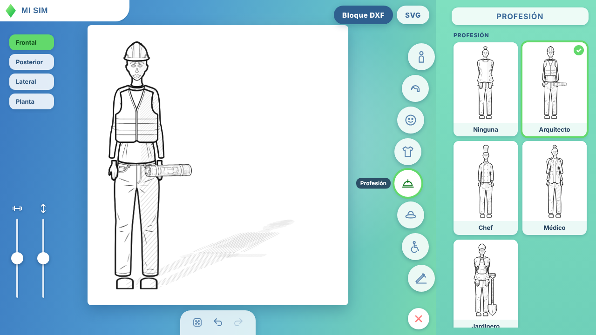

# SIMply Creator

Generador de **figuras humanas de línea para arquitectura** (el "SIM"), con interfaz de creador de
personajes. Personalizas cuerpo, cara, ropa, profesión y movilidad reducida, eliges el estilo de línea
como en Plantimania y exportas el SIM como **bloque de AutoCAD** o como **SVG**.



## Uso

Necesita un servidor HTTP (no funciona abriendo el archivo con `file://`):

```bash
python3 -m http.server 8000
```

Abre `http://localhost:8000`. En GitHub Pages funciona tal cual (Settings → Pages → *Deploy from a branch* → `main` / root).

## Qué se puede hacer

| Zona | Función |
|---|---|
| Vistas (izquierda) | Frontal · Posterior · Lateral · Planta |
| Sliders verticales | Complexión y estatura (doble clic para centrar) |
| Arco de categorías | Cuerpo · Peinado · Cara · Ropa · Profesión · Accesorio · Movilidad · Estilo de línea |
| Cara | Tamaño de ojos, boca y nariz **con regla de proporción** (ver abajo) |
| Movilidad | Sin ayuda · Silla de ruedas · Silla motorizada · Muletas · Bastón · Andador |
| Estilo de línea | Grosor de perímetro y de líneas interiores (mm de papel), sombreado interior (ninguno / tono / rayado), sombra proyectada, escala 1:20 · 1:50 · 1:100 |
| Barra inferior | Aleatorizar · deshacer · rehacer (`Ctrl+Z`) · ✕ resetear |
| Bloque DXF / SVG | Exportación |

### Regla de proporción

Los rasgos se miden respecto a la cabeza (`js/vector/proportions.js`). Si pides una boca o unos ojos
que no caben en la cara, **la cabeza entera crece** (hasta ×1,2) y el resto de rasgos se reajusta (por
ejemplo, una boca grande separa un poco los ojos). Si aun así no cabe, se limita y la interfaz lo avisa.
Las mismas reglas valen para ojos, nariz y boca, y las piezas de pelo, sombreros y barba se colocan
en función del cráneo ya escalado.

### El SIM es un bloque de AutoCAD

`Bloque DXF` genera un DXF R12 (abre en AutoCAD, BricsCAD, LibreCAD, DraftSight…) con:

- una definición `BLOCK` llamada `SIM_<NOMBRE>_<VISTA>` con punto base entre los pies, a nivel de suelo;
- una inserción `INSERT` en el modelo con **atributos** editables: `NOMBRE`, `GENERO`, `PROFESION`, `MOVILIDAD`, `VISTA`;
- capas `SIM-PERIMETRO` (polilíneas con grosor real = grosor de papel × escala), `SIM-INTERIOR`, `SIM-SOMBRA`;
- unidades en mm a tamaño real (una figura de pie mide unos 1.750 mm);
- **eliminación de líneas ocultas**: lo que queda detrás de otra pieza no se dibuja, igual que en la vista previa.

Verificado con `ezdxf` (lectura y auditoría sin errores, bloque, inserción y atributos presentes).

## Cómo está hecho

Las figuras se montan con un **kit de 65 piezas de línea** (cabezas, peinados, rasgos, torsos, prendas,
calzado, accesorios de profesión, ayudas de movilidad, símbolos en planta).

1. Cada pieza se generó como dibujo de línea aislado (IA, Magnific) y se **vectorizó en local con potrace**
   (`tools/vectorize.py`). Los PNG originales están en `assets/parts-src/` para poder re-vectorizar sin coste.
2. Cada SVG separa la **silueta** (se rellena de blanco para tapar lo que hay detrás y recibe el trazo de
   perímetro con el grosor elegido) de las **líneas interiores**. Así el perímetro y el interior se ajustan por separado.
3. `js/vector/figure.js` coloca las piezas según la vista, el género, la complexión, la estatura, la ropa,
   la profesión y la movilidad (incluida la pose sentada en silla).

```
index.html            interfaz 2D (la actual)
index-3d.html         primera versión 3D low-poly (se conserva como referencia)
css/style.css, css/app2d.css
js/app2d.js           interfaz, estado, historial, exportaciones
js/vector/
  kit.js              carga de piezas y aplanado de trazados
  figure.js           montaje de la figura por vista + opciones
  proportions.js      reglas de proporción de la cara
  render.js           SVG con perímetro, interior, sombreado y sombra
  dxf.js              bloque DXF con atributos y líneas ocultas eliminadas
tools/vectorize.py    PNG -> SVG (silueta + líneas) y manifest.json
assets/parts/         piezas vectoriales + manifest.json
assets/parts-src/     PNG fuente de cada pieza
docs/borradores/      borradores de estilo, interfaz y anatomía del bloque
```

Para regenerar las piezas tras cambiar el vectorizado:

```bash
pip install potracer numpy pillow
python3 tools/vectorize.py
```

## Limitaciones conocidas

- **Catálogo de piezas finito**: 2 cabezas frontales, 2 de perfil y 4 posteriores; las combinaciones son libres,
  pero no hay, por ejemplo, zapatos frontales dibujados (se usa un volumen simple) ni silla de ruedas frontal
  (al elegirla en frontal o posterior se muestra la lateral, con aviso).
- **Las piezas generadas no comparten exactamente el mismo trazo**, así que algunas uniones (cuello con cuello de
  camisa, mangas con brazos) son mejorables a mano.
- **Bloque DXF**: las líneas interiores llevan el contorno del trazo (dos bordes muy juntos). A escala de ploteo
  se ven como una línea, pero con mucho zoom se aprecian dobles. El sombreado interior solo se aplica al SVG.

## Integración en el portfolio

`portfolio/card.html` contiene una tarjeta lista para el índice del portfolio (sustituye `URL_PUBLICADA` por la
dirección de GitHub Pages).
